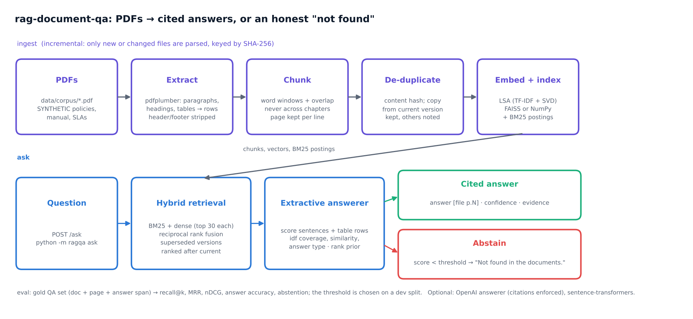
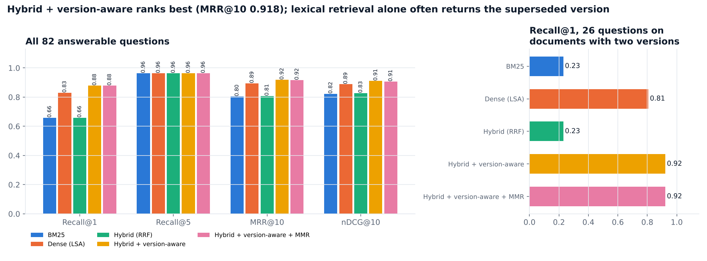
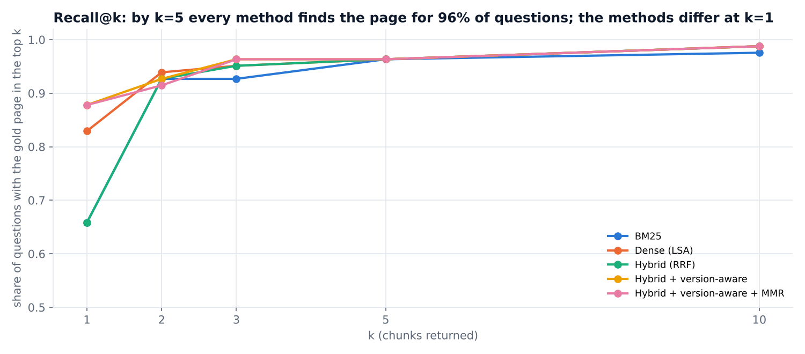
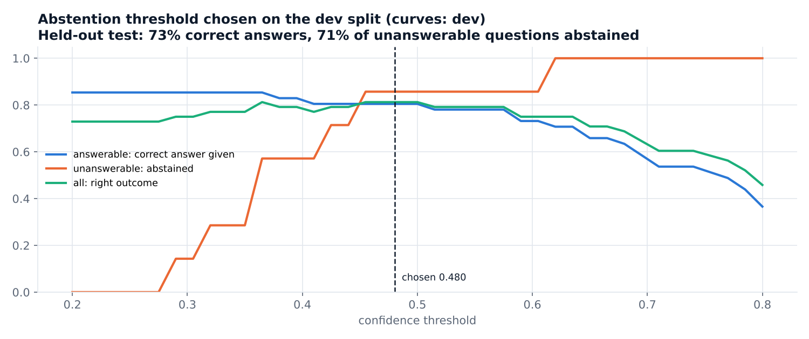
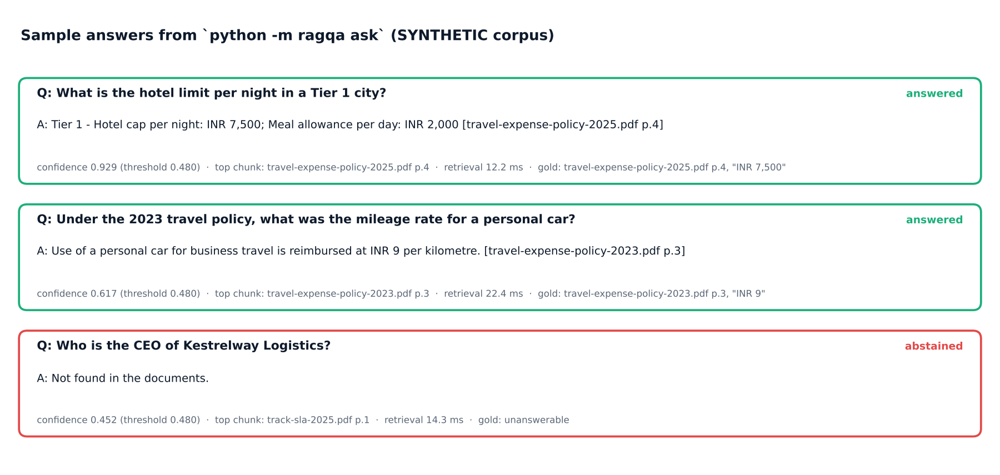
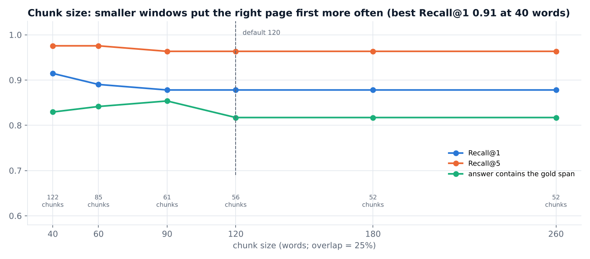

# RAG Document Q&A

[](https://github.com/vishavjit-singh/rag-document-qa/actions/workflows/ci.yml)


Question answering over a folder of PDFs. Every answer cites its source as `[file p.N]`, and when the documents do not support an answer the system says so.

- **Ingestion** that keeps the layout: paragraphs, headings and tables come out of pdfplumber, tables are turned into one self-contained line per row, and running headers and footers are removed. It is incremental: only new or changed files are parsed (keyed by SHA-256), and duplicate chunks are collapsed by content hash.
- **Hybrid retrieval**: a BM25 implementation plus dense vectors (FAISS when installed, exact NumPy search otherwise), fused with reciprocal rank fusion. It is **version-aware**: when a policy exists in two versions, the superseded one ranks lower unless the question names its year or version.
- **Grounded answers**: an extractive answerer picks the best-supported sentence or table row and cites it. Below a confidence threshold it abstains with "Not found in the documents." An optional OpenAI answerer uses the same retrieval, is told to cite every claim, and has its citations checked.
- **Evaluation** against a gold set of 96 questions with document, page and answer span. It reports recall@k, MRR and nDCG, answer accuracy, abstention on unanswerable questions, latency, a chunk-size sweep and pdfplumber vs pypdf.
- **API**: `POST /ask`, `POST /ingest` (rescan the folder or upload a PDF), `GET /documents`, `GET /health`.

The corpus is **SYNTHETIC**: nine PDFs (54 pages) for a fictional company, "Kestrelway Logistics". They include an HR handbook, two versions of a travel policy, an IT security handbook, a device manual, two versions of an SLA, safety procedures and a claims policy. All of it is generated with reportlab from [`spec.py`](src/ragqa/synth/spec.py). The gold page of each fact is recorded by the layout engine while the PDF is built, so the gold set does not depend on the extraction code being evaluated.



## Why this project

| Problem with document Q&A | How this repo handles it |
|---|---|
| PDF text comes out as a stream with page furniture and broken tables | pdfplumber lines are grouped into paragraphs by vertical gaps, and headings are found by font size and weight. Tables are detected and linearised as `Tier 1 - Hotel cap per night: INR 7,500; Meal allowance per day: INR 2,000`. Lines that repeat in the top or bottom band of most pages are dropped |
| Chunks cut facts in half or mix unrelated sections | Word windows with overlap never cross a chapter. They prefer to end on a section boundary, then on a paragraph or table-row boundary, and overlap is only applied inside a section. Every line keeps its page and section |
| Old and new versions of a policy both match the question | Document control fields (version, status, effective date) are parsed from the title page. Superseded versions rank after current ones, unless the question names a year or version ("the 2023 policy"). Then the other versions of that document move down instead |
| Keyword search misses paraphrases, embeddings miss exact terms | BM25 and dense retrieval (30 candidates each) are fused with reciprocal rank fusion. MMR is available for diversity |
| Answers without sources can't be checked | Every answer cites `[file p.N]` from the line it came from. The LLM backend's citations are validated against the retrieved pages, and an answer with no valid citation becomes an abstention |
| A RAG system that always answers will make things up | The extractive answerer has a confidence threshold, chosen on a dev split, and the evaluation reports how often it abstains on questions the corpus cannot answer |
| Re-indexing everything on every change | Extraction is cached per file hash, deleted files drop out, unchanged corpora are a no-op. A stateless embedder keeps the vectors of unchanged chunks |
| A library missing in one environment breaks the system | The embedder, vector index, answerer and web framework each sit behind a small interface with a local fallback. The real backends run in CI jobs |

## Results from the demo run

`make demo` generates the corpus, ingests it, evaluates, asks three example questions and renders these images from `reports/`. The 96 gold questions are split into dev and test halves (seed 7). 82 are answerable, 26 of them on documents that exist in two versions, and 14 are not answerable from the corpus. Ingestion produced 58 chunks, and 2 exact duplicates were collapsed (the identical introduction chapters of the two travel-policy versions and of the two SLA versions), leaving 56. Embeddings are LSA (TF-IDF on words and character n-grams, reduced to 160 dimensions with TruncatedSVD).

**Retrieval.** At k=5 every method finds the gold page for 96% of questions. They differ at rank 1, and most of that difference comes from document versions. BM25 sees two near-identical travel policies and two near-identical SLAs and picks the superseded one for most version questions (recall@1 0.23 on those 26). Fusing BM25 with the dense ranking does not fix that. Version-aware ranking does: recall@1 goes from 0.66 to 0.88 overall and from 0.23 to 0.92 on the version questions.





| Retriever (82 answerable questions) | Recall@1 | Recall@3 | Recall@5 | MRR@10 | nDCG@10 | Recall@1, version questions | p50 latency |
|---|---|---|---|---|---|---|---|
| BM25 | 0.658 | 0.927 | 0.963 | 0.804 | 0.823 | 0.231 | 0.09 ms |
| Dense (LSA) | 0.829 | 0.951 | 0.963 | 0.895 | 0.888 | 0.808 | 10.12 ms |
| Hybrid (RRF) | 0.658 | 0.951 | 0.963 | 0.807 | 0.828 | 0.231 | 7.83 ms |
| **Hybrid + version-aware** (default) | **0.878** | **0.963** | **0.963** | **0.918** | **0.911** | **0.923** | 9.40 ms |
| Hybrid + version-aware + MMR | 0.878 | 0.963 | 0.963 | 0.916 | 0.906 | 0.923 | 11.72 ms |

Latency is per query on the machine this was built on; it changes from run to run and will differ elsewhere (the quality metrics are deterministic). The dense part is dominated by turning the question into an LSA vector, not by the search itself.

**Answers and abstention.** The threshold is chosen on the dev split (0.480), and the numbers below are for the held-out test split. "Correct" means the answer contains the gold span. "Citation" means it cites the gold document and page.



| Answers (extractive, test split: 41 answerable + 7 unanswerable) | Value |
|---|---|
| Answerable questions answered correctly | 0.732 (0.780 if it never abstained) |
| Answers citing the gold document and page | 0.829 |
| Unanswerable questions where it abstained (abstention recall) | 0.714 (5 of 7) |
| Abstentions that were right (abstention precision) | 0.455 |
| Right outcome over all 48 test questions | 0.729 (dev: 0.812) |
| End-to-end `ask` latency, p50 / p95 | 36.78 / 44.86 ms |



The weak link is **sentence selection, not retrieval**. The gold page is in the top 5 for 96% of questions, but the answerer picks a sentence containing the gold span for 78% (test, before abstention). The misses listed in `reports/answers.csv` are what a lexical-plus-LSA scorer is expected to get wrong:

- **Neighbouring sentences.** "What is the first response time for a P1 incident?" returns "P1 incidents are handled 24x7." instead of the table row with "30 minutes".
- **Paraphrases with no shared terms.** "own car" vs "personal car", or "MFA" vs "multi-factor authentication".
- **Unanswerable questions that are close to a real topic.** "How many days of paid leave do contractors in Germany receive?" is answered with the sick-leave sentence.
- **One correct answer below the threshold.** For "What uptime did the 2024 SLA commit to?" retrieval finds the right page and sentence, but nothing in the sentence says "SLA" or "commit", so it scores 0.269 and abstains.

A cross-encoder reranker or the LLM backend is the natural next step (see the roadmap).

**Chunk size and extractor.** Sections in these documents are short, so chunks of 120 words or more mostly hold one whole chapter, and the results stop changing from 120 words up. Smaller windows put the gold page first more often (recall@1 0.915 at 40 words, 0.878 at 120). The default stays at 120 rather than being tuned on the gold set. pypdf, the plain-text fallback, retrieves about as well (recall@1 0.866 vs 0.878) and scored slightly higher on answer spans (0.842 vs 0.817). What it loses is the table structure: a pypdf table row reads "Tier 1 INR 7,500 INR 2,000", and the column names are gone.



> Every number here is in `reports/eval.json` after `make demo`, and the per-question outcomes are in `reports/answers.csv`. The corpus, the questions and the company are **synthetic**. The questions were written by the same person who wrote the documents, so they are easier than real user questions, and the results are not a benchmark.

## Quickstart

```bash
git clone https://github.com/vishavjit-singh/rag-document-qa.git
cd rag-document-qa
python -m venv .venv && source .venv/bin/activate
make install
make demo        # corpus → ingest → eval (calibrates the threshold) → example questions → charts (under a minute)
make test        # 52 tests (the FastAPI, FAISS and sentence-transformers ones skip if those aren't installed)
make serve       # API on http://127.0.0.1:8000 (FastAPI docs at /docs when FastAPI is installed)
```

Optional backends: `make install-extras` installs `faiss-cpu` and `sentence-transformers`. Then use `RAGQA_INDEX=faiss`, or `RAGQA_EMBEDDER=sentence-transformers python -m ragqa ingest`. To use your own PDFs, put them in `data/corpus/` (or point `paths.corpus` in [`ragqa.yaml`](ragqa.yaml) somewhere else) and run `python -m ragqa ingest`.

## Usage

### CLI

```text
$ python -m ragqa ask "Under the 2023 travel policy, what was the mileage rate for a personal car?"
Use of a personal car for business travel is reimbursed at INR 9 per kilometre. [travel-expense-policy-2023.pdf p.3]
  confidence 0.617 | extractive | hybrid | retrieval 28.43 ms
  #1 travel-expense-policy-2023.pdf p.3 | 2. Approval and booking
  #2 travel-expense-policy-2023.pdf p.6 | 5. Corporate card > 5.1 Card limit and use
  ...

$ python -m ragqa ask "Who is the CEO of Kestrelway Logistics?"
Not found in the documents.
  confidence 0.452 | extractive | hybrid | retrieval 45.01 ms
```

| Command | What it does |
|---|---|
| `python -m ragqa generate` | writes the SYNTHETIC PDFs to `data/corpus/` and the gold set to `data/gold/qa.jsonl` |
| `python -m ragqa ingest [--rebuild] [--embedder lsa\|hashing\|sentence-transformers] [--engine pdfplumber\|pypdf]` | incremental indexing; prints what was added, changed, removed and parsed |
| `python -m ragqa ask "..." [-k 5] [--mode bm25\|dense\|hybrid] [--answerer extractive\|openai] [--json]` | answer with citations; `--json` adds evidence, scores and per-retriever ranks |
| `python -m ragqa eval [--no-sweep]` | metrics → `reports/eval.json`, `reports/answers.csv`; saves the dev-calibrated threshold next to the index |
| `python -m ragqa report` · `summary` · `serve` | README images · print the last evaluation · run the API |

### API

```bash
curl -s localhost:8000/health
# {"status":"ok","documents":9,"chunks":56,"embedder":"lsa","index_backend":"numpy","answer_backend":"extractive",
#  "threshold":0.4805,"threshold_source":"calibrated on the dev split"}

curl -s -X POST localhost:8000/ask -H 'content-type: application/json' \
  -d '{"question": "How quickly must critical security patches be installed?"}'
# {"question": "...", "answer": "Critical security patches must be installed within 72 hours.", "abstained": false,
#  "confidence": 0.905, "citations": [{"doc": "information-security-handbook.pdf", "page": 4,
#  "section": "3.3 Patching", ...}], "evidence": [...], "retrieved": [...], "latency_ms": {...},
#  "answer_with_citations": "Critical security patches must be installed within 72 hours. [information-security-handbook.pdf p.4]"}

curl -s localhost:8000/documents                       # files with version, status, pages, chunk count, hash
curl -s -X POST localhost:8000/ingest -H 'content-type: application/json' -d '{}'            # rescan the folder
curl -s -X POST 'localhost:8000/ingest?filename=new-policy.pdf' -H 'content-type: application/pdf' \
  --data-binary @new-policy.pdf                        # store and index one PDF
```

`/ask` accepts `k` (1–20), `mode`, `answerer`, `version_aware` and `mmr`. Unknown fields and out-of-range values return `422` with the field path, malformed JSON returns `400`, and asking for the OpenAI answerer without `OPENAI_API_KEY` returns `400`. `docker compose up --build` serves the same API from an image that builds and indexes the corpus at build time.

### Optional LLM answers

With `OPENAI_API_KEY` set, `--answerer openai` (or `"answerer": "openai"`) sends the top chunks to the Chat Completions API through plain `urllib`. Each line in the context carries its `[file p.N]` tag, and the system prompt allows only the context, requires a citation on every claim, and requires the exact abstention sentence when the answer is missing. Citations to pages that were not retrieved are removed, and an answer with no valid citation is returned as "Not found in the documents." The demo, the tests and CI never call the API; the tests use a fake HTTP opener.

## Project structure

```
├── ragqa.yaml                    # paths, chunking, embedder, index backend, retrieval and answer settings
├── src/ragqa/
│   ├── synth/spec.py · build.py  # SYNTHETIC documents + gold QA set; reportlab PDFs with gold pages recorded
│   ├── extract.py                # pdfplumber (layout-aware) and pypdf extraction, header/footer stripping, tables
│   ├── chunking.py               # heading-aware windows with overlap, content-hash de-duplication
│   ├── store.py                  # incremental ingest, extraction cache, on-disk index
│   ├── embed.py · vindex.py      # LSA / hashing / sentence-transformers · FAISS / NumPy
│   ├── bm25.py · retrieve.py     # BM25, RRF fusion, version-aware ranking, MMR
│   ├── answer.py · llm.py        # extractive answerer with abstention · OpenAI answerer with citation checks
│   ├── evaluate.py               # recall@k, MRR, nDCG, answer and abstention metrics, sweeps
│   ├── service.py                # engine shared by the CLI and both APIs
│   ├── api.py · api_fastapi.py   # Starlette app · the same API on FastAPI
│   └── report.py · cli.py
├── tests/                        # 52 tests, incl. a tiny ASGI client (no httpx needed)
├── Dockerfile · docker-compose.yml · Makefile
└── .github/workflows/ci.yml      # tests + demo · FAISS parity · sentence-transformers · Docker smoke test
```

## Testing

```bash
make lint && make test
```

- **Corpus:** PDFs are byte-for-byte reproducible. Each gold answer span is found on its recorded page by an independent pypdf read, and every page carries the SYNTHETIC label
- **Extraction:** running headers and footers are removed on every page, tables come out as rows with column names, and heading levels and document control fields are right. The pypdf fallback recovers the same metadata, and the cleaning helpers handle hyphenation and bullets
- **Chunking and ingest:** windows respect size and boundaries and never overlap across a section. Each line keeps its page. Dedup keeps the current version's copy. Re-ingesting unchanged files is a no-op, while added, changed and deleted files are detected. A settings change re-chunks without re-parsing, and the hashing embedder re-embeds only new chunks
- **Retrieval:** BM25 matches the formula by hand and RRF and MMR behave as specified. NumPy search is exact. FAISS matches NumPy on the demo index and the IVF path works (CI). Version-aware ranking picks the current policy by default and the 2023 one when asked
- **Answers:** citations point at the gold page, abstention works below the threshold, and the hand-computed recall, MRR and nDCG and the threshold calibration are checked. The OpenAI backend's request, citation filtering and abstention are tested against a fake HTTP opener
- **API:** health, documents, ask, validation errors, malformed JSON, the missing-key error, folder rescan and PDF upload (bad filename, non-PDF, duplicate content). Each test runs against the Starlette app, and against the FastAPI app when FastAPI is installed
- **End to end:** evaluation on the demo index (version-aware hybrid beats BM25, the calibration file and per-question CSV are written), the CLI `ask` and the report images

## Limitations and roadmap

- **Not run locally.** FastAPI, FAISS and sentence-transformers could not be installed where this was built. Locally the API ran on Starlette (FastAPI is built on it) and vectors were searched with NumPy. The FastAPI app, the FAISS parity and IVF tests, the demo on a FAISS index, the MiniLM embedder and the Docker build first run in the CI jobs. The OpenAI backend has only been tested against a fake HTTP opener, never against the real API.
- **Synthetic, small and friendly data.** Nine generated PDFs with clean layouts, and questions written alongside the documents. Scanned PDFs (no OCR here), multi-column layouts, real user phrasing and a large corpus would all lower these numbers.
- **The answerer is extractive and lexical at heart.** It returns one sentence or table row and cannot combine facts from two places. Its confidence separates unanswerable questions only partly: 5 of 7 abstained on test, and about half of all abstentions were on answerable questions. The test split has only 7 unanswerable questions, so those rates are coarse.
- **Tuning.** The scoring weights were compared on the dev split only, and the threshold is calibrated there. Chunk size, RRF k and the candidate count are defaults that were not tuned.
- **Next:** a cross-encoder reranker for sentence selection, an LLM judge for abstention, OCR (pytesseract) for scanned pages, metadata filters in `/ask` (document, status, date), and evaluation of the LLM backend for faithfulness on the same gold set.

## Author

**Vishavjit Singh Saini**, Data Engineer
[Portfolio](https://vishavjit-singh.pages.dev/) · [LinkedIn](https://www.linkedin.com/in/vishavjit-singh-7011211ab/) · [GitHub](https://github.com/vishavjit-singh)

## License

[MIT](LICENSE)
